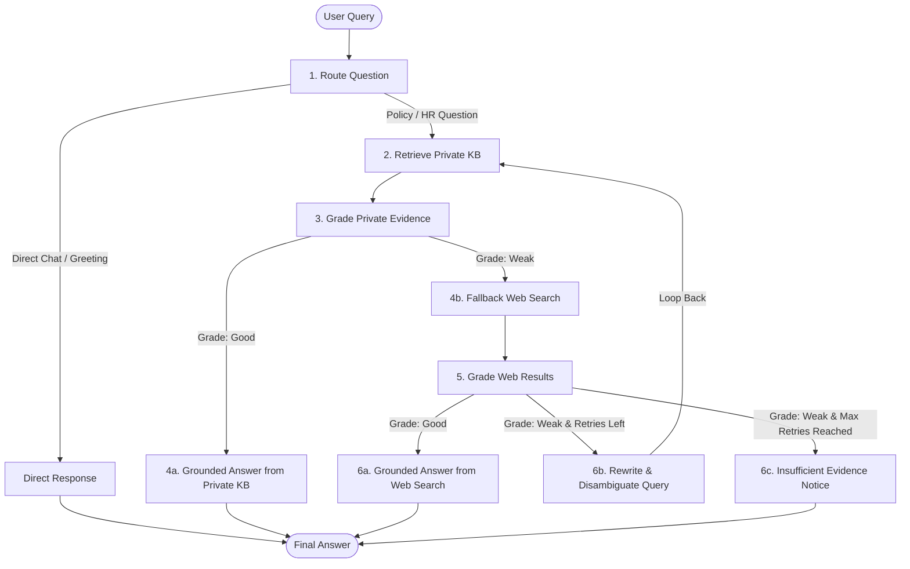

# Enterprise HR Policy Agentic RAG Copilot

[](https://www.python.org/)
[](https://fastapi.tiangolo.com)
[](https://langchain-ai.github.io/langgraph/)
[](https://www.pinecone.io/)
[](https://groq.com/)
[](LICENSE)

An enterprise-grade, autonomous **Agentic~ Retrieval-Augmented Generation (RAG)** platform designed to provide accurate, grounded, and policy-compliant answers to employee queries.

Unlike naive RAG systems that blindly fetch top-$k$ chunks and inject them into an LLM prompt, this copilot implements an **agentic state-machine workflow powered by LangGraph**. It evaluates private company knowledge first, scores evidence relevance using LLM-as-a-judge, automatically triggers real-time public web retrieval when internal evidence is insufficient, self-corrects ambiguous queries, and logs an immutable audit trail into an internal database.

---

## Table of Contents

- [Key Architectural Highlights](#key-architectural-highlights)
- [System Architecture & Workflow](#system-architecture--workflow)
- [Comprehensive Tech Stack](#comprehensive-tech-stack)
- [Repository Structure](#repository-structure)
- [Prerequisites & Environment Setup](#prerequisites--environment-setup)
- [Quick Start Guide](#quick-start-guide)
- [Deep Dive: Core Modules & Engineering Logic](#deep-dive-core-modules--engineering-logic)
  - [1. LangGraph State Machine (`app/rag/workflow.py`)](#1-langgraph-state-machine-appragworkflowpy)
  - [2. Pinecone Vectorstore Lifecycle (`app/rag/vectorstore.py`)](#2-pinecone-vectorstore-lifecycle-appragvectorstorepy)
  - [3. Multi-Format Ingestion Pipeline (`app/services/ingestion.py`)](#3-multi-format-ingestion-pipeline-appservicesingestionpy)
  - [4. Enterprise Audit Ledger (`app/services/audit.py`)](#4-enterprise-audit-ledger-appservicesauditpy)
  - [5. Zero-Overlap Responsive UI (`templates/` & `static/`)](#5-zero-overlap-responsive-ui-templates--static)
- [REST API Specification](#rest-api-specification)
- [Document Ingestion (CLI & Web UI)](#document-ingestion-cli--web-ui)
- [Observability & Audit Trail](#observability--audit-trail)
- [Production Deployment Recommendations](#production-deployment-recommendations)
- [License](#license)

---

## Key Architectural Highlights

- **Semantic Intent Routing**: Distinguishes between conversational messages (greetings/thanks) and HR policy questions to bypass unnecessary vector search.
- **Evidence Grading (Self-RAG)**: Employs structured JSON evaluation to grade retrieved chunks as `good` or `weak`, preventing hallucinations caused by low-relevance documents.
- **Dynamic Web Fallback**: Integrates the **Tavily Search API** to fetch authoritative public employment laws, tax rules, or holiday schedules when company documentation does not contain the answer.
- **Query Rewriter Loop**: Automatically refines, disambiguates, and enriches employee questions with HR keywords if initial retrieval fails, executing up to $N$ retry cycles.
- **Source Attributions & Citations**: Explicitly flags every answer with its provenance (`private_kb`, `web_search`, `direct`, or `insufficient_evidence`) alongside source links.
- **Enterprise Security & Governance**: Requires an administrative API key (`X-Admin-Key`) for indexing new documents and records every query, source, and trace into SQLite.
- **Zero-Overlap Modern UI**: Pinned 3-column layout with independent scrolling containers, dark theme, and mobile offcanvas drawers built with Bootstrap 5.3 and custom CSS.

---

## System Architecture & Workflow

The core reasoning engine is built as a cyclic directed graph (`StateGraph`) using **LangGraph**:



### Graph Node Execution Logic

1. **`route_question`**: Uses Groq LLM with structured outputs (`RouteDecision: Literal["kb", "direct"]`) to classify the user's intent.
2. **`retrieve_kb`**: Executes cosine similarity search over Pinecone namespaces using dense vector embeddings ($k=4$).
3. **`grade_kb`**: Evaluates whether retrieved internal documents directly and sufficiently answer the question.
4. **`generate_from_kb`**: Generates a professional, policy-grounded response citing specific company document titles.
5. **`search_web`**: When internal documentation is missing or insufficient, dispatches a real-time query to Tavily.
6. **`grade_web`**: Verifies that the external search output is factual, relevant, and authoritative.
7. **`generate_from_web`**: Formulates a response from external evidence with a clear disclosure requiring HR confirmation.
8. **`rewrite_query`**: In case of low-quality matches, transforms colloquial questions into optimized domain search keywords.
9. **`insufficient`**: Gracefully terminates execution if no reliable evidence exists across private and public sources.

---

## Comprehensive Tech Stack

| Layer | Technology | Version | Purpose & Rationale |
| :--- | :--- | :--- | :--- |
| **Orchestration** | **LangGraph** | `1.1.10` | Stateful, cyclic multi-agent graph with conditional branch routing and loop management. |
| **Agent Framework** | **LangChain Core / Community** | `1.6.1` / `0.4.2` | Document abstractions, prompt chaining, and unified model interfaces. |
| **LLM Provider** | **Groq Cloud API** | `openai/gpt-oss-120b` | High-throughput, sub-second latency inference utilizing Groq's Tensor Streaming Processing (LPU). |
| **Vector Database** | **Pinecone Serverless** | `7.3.0` | Cloud-native vector database deployed on AWS `us-east-1` with cosine distance metric and namespace isolation. |
| **Embeddings** | **HuggingFace Sentence Transformers** | `all-MiniLM-L6-v2` | Fast, lightweight 384-dimensional dense semantic embeddings computed locally with zero API cost. |
| **Search Engine** | **Tavily Search API** | `0.2.18` | Search engine built specifically for AI agents, delivering pre-filtered, structured web evidence. |
| **Backend Framework** | **FastAPI** | `0.116.1` | High-performance asynchronous REST API supporting Pydantic validation, file uploads, and static serving. |
| **ASGI Web Server** | **Uvicorn** | `0.35.0` | Production ASGI web server running with standard event-loop optimizations. |
| **Audit Ledger** | **SQLite 3** | Built-in | Pinned relational database recording timestamps, user queries, final source types, and full execution traces. |
| **Document Loaders** | **PyPDF, python-docx, TextLoader** | Latest | Parses PDF handbooks, Word DOCX SOPs, Markdown guides, and plain text files. |
| **Text Chunking** | **RecursiveCharacterTextSplitter** | `1.1.2` | Splits documents into 900-character chunks with 120-character overlap to preserve semantic context across boundaries. |
| **Front-End UI** | **HTML5, Vanilla JS, Bootstrap 5.3** | `5.3.3` | Responsive 3-column dashboard with dark theme, real-time trace viewing, and zero-overlap layout. |
| **Package Manager** | **UV / Pip** | Latest | Fast dependency resolution and virtual environment management. |

---

## Repository Structure

```
Enterprises_AI/
├── .env                              # Environment secrets (API keys, index names)
├── .env.example                      # Environment variables template
├── .gitignore                        # Git exclusion rules
├── LICENSE                           # Open-source license file
├── README.md                         # Comprehensive project documentation
├── pyproject.toml                    # UV / PEP-518 project specification
├── requirements.txt                  # Locked pip dependency declarations
├── run.py                            # Application entry point (Uvicorn starter)
├── ingest_sample_kb.py               # Batch ingestion script for sample HR documents
├── test.py                           # Quick testing script for document chunking
│
├── app/
│   ├── main.py                       # FastAPI application factory & static routes
│   │
│   ├── api/
│   │   └── routes.py                 # REST endpoints: /api/chat, /api/ingest, /api/health
│   │
│   ├── core/
│   │   ├── config.py                 # Pydantic Settings management (.env loader)
│   │   └── logging.py                # Structured console logging configuration
│   │
│   ├── rag/
│   │   ├── state.py                  # LangGraph AgentState TypedDict & Pydantic models
│   │   ├── vectorstore.py            # Pinecone client, embedding loader, index manager
│   │   └── workflow.py               # 10-node LangGraph cyclic state machine
│   │
│   └── services/
│       ├── audit.py                  # SQLite query and execution trace logger
│       └── ingestion.py              # File loader & recursive chunking logic
│
├── data/
│   ├── audit.db                      # SQLite audit storage (auto-initialized)
│   └── sample_kb/                    # Default enterprise documentation
│       ├── company_hr_handbook.md    # Leave, remote work, equipment policies
│       └── hr_operations_runbook.md  # Grievance, onboarding, performance review SOPs
│
├── static/
│   ├── css/
│   │   └── style.css                 # Zero-overlap CSS design system & dark theme
│   └── js/
│       └── app.js                    # Chat controller, auto-resizing input, drawers
│
├── templates/
│   └── index.html                    # Jinja2 dashboard template
│
└── uploads/                          # Staging directory for ingested documents
```

---

## Prerequisites & Environment Setup

### 1. Requirements

- **Python**: Version `3.12` or higher (verified with Python `3.14`).
- **UV Package Manager** (recommended) or standard `pip`.
- **API Keys**:
  - [Groq Cloud](https://console.groq.com/) (LLM inference)
  - [Pinecone](https://www.pinecone.io/) (Vectorstore)
  - [Tavily](https://tavily.com/) (Web search fallback)
  - *(Optional)* [LangSmith](https://smith.langchain.com/) (Observability)

### 2. Configure Environment Variables

Create a `.env` file in the project root directory:

```bash
cp .env.example .env
```

Populate the required credentials:

```dotenv
# App Metadata
APP_NAME="Enterprise HR Policy Agentic RAG Copilot"
APP_ENV=development

# Groq Cloud
GROQ_API_KEY="gsk_your_groq_api_key_here"
GROQ_MODEL="openai/gpt-oss-120b"

# Pinecone Vectorstore
PINECONE_API_KEY="pcsk_your_pinecone_api_key_here"
PINECONE_INDEX_NAME="fde-hr-policy-rag"
PINECONE_NAMESPACE="company-hr-kb"

# HuggingFace Embedding Model
EMBEDDING_MODEL="sentence-transformers/all-MiniLM-L6-v2"

# Tavily Search Fallback
TAVILY_API_KEY="tvly-your_tavily_api_key_here"

# Security & Constraints
ADMIN_API_KEY="admin123"
TOP_K=4
MAX_RETRIES=1

# Optional: LangSmith Tracing
LANGSMITH_TRACING=false
LANGSMITH_ENDPOINT="https://api.smith.langchain.com"
LANGSMITH_API_KEY=""
LANGSMITH_PROJECT="Enterprises-ai"
```

---

## Quick Start Guide

### Step 1: Clone and Set Up Virtual Environment

```bash
# Clone the repository
git clone https://github.com/your-username/enterprises-ai.git
cd enterprises-ai

# Create virtual environment
python -m venv .venv

# Activate on Windows (PowerShell)
.venv\Scripts\Activate.ps1
# Activate on Linux / macOS
source .venv/bin/activate
```

### Step 2: Install Dependencies

Using `uv` (faster):
```bash
uv pip install -r requirements.txt
```

Or standard `pip`:
```bash
pip install -r requirements.txt
```

### Step 3: Ingest Sample HR Knowledge Base

Bootstrap Pinecone with the sample company handbooks provided in `data/sample_kb/`:

```bash
python ingest_sample_kb.py
```
*Output:*
```text
Indexed 2 files -> 18 chunks -> 18 Pinecone vectors
```

### Step 4: Run the Copilot

```bash
python run.py
```

The application will start on `http://127.0.0.1:8080`. Open your browser and begin querying the copilot!

---

## Deep Dive: Core Modules & Engineering Logic

### 1. LangGraph State Machine (`app/rag/workflow.py`)

The application state is modeled with Python `TypedDict` and Pydantic structured output models:

```python
class AgentState(TypedDict):
    question: str
    current_query: str
    kb_docs: List[Document]
    web_results: str
    kb_grade: str
    web_grade: str
    answer: str
    source_used: str
    retry_count: int
    trace: List[str]
    citations: List[dict]
```

#### Self-Correction & Evidence Evaluation
The system utilizes LLM-as-a-judge prompts using `llm().with_structured_output(EvidenceGrade, method="json_mode")`. If the model determines that private chunks do not contain a conclusive answer:
1. It avoids making up arbitrary policies.
2. It grades the internal evidence as `weak`.
3. The graph conditionally routes the query to `search_web`.
4. If web results are also inconclusive and `retry_count < max_retries`, the query is rewritten by `rewrite_query` and re-evaluated through the graph.

---

### 2. Pinecone Vectorstore Lifecycle (`app/rag/vectorstore.py`)

To ensure reliability across different embedding configurations, `vectorstore.py` manages the vector index lifecycle automatically:

- **Dimension Mapping**: Resolves embedding dimensions dynamically (e.g., `all-MiniLM-L6-v2` $\rightarrow 384$, `text-embedding-3-small` $\rightarrow 1536$).
- **Serverless Index Auto-Provisioning**: Checks if the specified index exists on Pinecone. If absent or configured with mismatched dimensions, it provisions a new Serverless index on AWS `us-east-1` with cosine similarity.
- **Namespace Isolation**: Segregates records under `settings.pinecone_namespace` (default: `company-hr-kb`), allowing multiple departments or document types to coexist without data pollution.

---

### 3. Multi-Format Ingestion Pipeline (`app/services/ingestion.py`)

The ingestion module supports four major enterprise document formats:

```python
SUPPORTED = {".pdf", ".txt", ".md", ".docx"}
```

- **Chunking Parameters**: `chunk_size=900`, `chunk_overlap=120`.
- **Metadata Tagging**: Preserves the originating file name and chunk start index in each chunk's `metadata`, enabling precise citation rendering in the user interface.

---

### 4. Enterprise Audit Ledger (`app/services/audit.py`)

Every interaction is captured inside SQLite (`data/audit.db`) for regulatory compliance, transparency, and latency monitoring:

```sql
CREATE TABLE IF NOT EXISTS query_audit (
    id INTEGER PRIMARY KEY AUTOINCREMENT,
    created_at TEXT NOT NULL,
    question TEXT NOT NULL,
    source_used TEXT NOT NULL,
    trace_json TEXT NOT NULL
);
```

---

### 5. Zero-Overlap Responsive UI (`templates/` & `static/`)

The front-end is engineered to provide an enterprise-grade experience:
- **Locked Viewport (`100dvh`)**: Avoids global window overflow and layout breaking.
- **Independent Scroll Areas**: Chat feed, trace panel, and sidebar scroll on their own axes.
- **Live Trace Feed**: Shows the step-by-step decision sequence of LangGraph in real time.
- **Keyboard Shortcuts**: Send with `Enter`, insert multiline input with `Shift + Enter`.
- **Drawer Panels**: Seamless offcanvas drawers for tablets and mobile devices.

---

## REST API Specification

### 1. Health Check
```http
GET /api/health
```
**Response (200 OK):**
```json
{
  "status": "ok",
  "service": "Enterprise HR Policy Agentic RAG Copilot"
}
```

---

### 2. Chat with Copilot
```http
POST /api/chat
Content-Type: application/json
```
**Request Body:**
```json
{
  "question": "What is our remote work policy and equipment stipend?"
}
```
**Response (200 OK):**
```json
{
  "answer": "According to the company HR policy, full-time employees are eligible for a hybrid remote work model with up to 3 days remote per week. Employees also receive a one-time $500 home-office equipment stipend upon onboarding.",
  "source_used": "private_kb",
  "trace": [
    "Router → KB",
    "Private KB retrieval → 4 chunks",
    "KB evidence grade → GOOD",
    "Answer generation → PRIVATE KB"
  ],
  "citations": [
    {
      "title": "company_hr_handbook.md",
      "url": "",
      "type": "private_kb"
    }
  ],
  "rewritten_query": "What is our remote work policy and equipment stipend?"
}
```

---

### 3. Ingest HR Document
```http
POST /api/ingest
Header: X-Admin-Key: <ADMIN_API_KEY>
Content-Type: multipart/form-data
```
**Form Data:**
- `file`: Binary document file (`.pdf`, `.docx`, `.md`, `.txt`).

**Response (200 OK):**
```json
{
  "message": "Document indexed",
  "file": "Q3_Leave_Policy_Update.pdf",
  "chunks": 6,
  "ids_created": 6
}
```

---

## Document Ingestion (CLI & Web UI)

### Option A: Via Web Dashboard
1. Click the **"+ Add HR Document"** button in the left sidebar.
2. Enter your administrative key (default: `admin123`).
3. Select your `.pdf`, `.docx`, `.md`, or `.txt` file.
4. Click **"Index Document"**. The vector store will chunk and embed the document in real time.

### Option B: Via cURL
```bash
curl -X POST "http://127.0.0.1:8080/api/ingest" \
  -H "X-Admin-Key: admin123" \
  -F "file=@/path/to/your/company_policy.pdf"
```

---

## Observability & Audit Trail

### Querying Audit Records
To inspect recent user interactions and execution routes:

```bash
python -c "
import sqlite3, json
con = sqlite3.connect('data/audit.db')
for row in con.execute('SELECT created_at, question, source_used, trace_json FROM query_audit ORDER BY id DESC LIMIT 5'):
    print(f'[{row[0]}] Question: {row[1]} | Source: {row[2]}')
    print('Trace:', json.loads(row[3]))
    print('-'*60)
"
```

### LangSmith Tracing
To visualize the state graph transitions inside LangSmith:
1. Set `LANGSMITH_TRACING=true` in `.env`.
2. Provide your `LANGSMITH_API_KEY` and `LANGSMITH_PROJECT`.
3. Every graph run will automatically upload execution spans and latency breakdowns to your LangSmith dashboard.

---

## Production Deployment Recommendations

1. **ASGI Workers**: Run behind a production reverse proxy (Nginx or AWS ALB) using multiple Uvicorn workers:
   ```bash
   uvicorn app.main:app --host 0.0.0.0 --port 8080 --workers 4
   ```
2. **Persistent Storage**: Mount a persistent volume for `data/` (`audit.db`) and `uploads/` when deploying via Docker or Kubernetes.
3. **Key Rotation**: Change the default `ADMIN_API_KEY` in `.env` to a cryptographically secure random string before publishing to production.
4. **CORS Configuration**: If embedding this copilot inside an intranet or internal portal, specify allowed origins in `app/main.py`.

---

## License

This project is licensed under the **MIT License**. See the [LICENSE](LICENSE) file for complete details.
